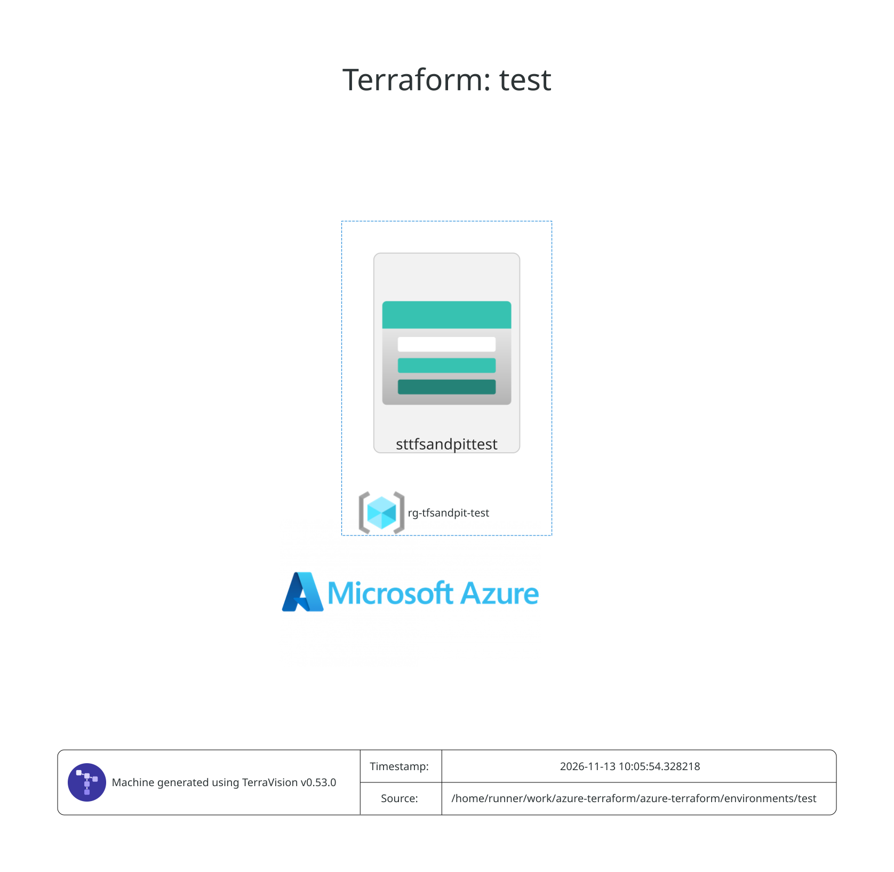

# Terraform Documentation

## Environment: dev

### Requirements

| Name      | Version  |
| --------- | -------- |
| terraform | >= 1.7   |
| azapi     | ~> 2.4   |
| azurerm   | >= 5.4.0 |

### Providers

| Name      | Version |
| --------- | ------- |
| terraform | n/a     |

### Modules

| Name                                           | Source                        | Version |
| ---------------------------------------------- | ----------------------------- | ------- |
| [naming](./modules/core/naming/README.md)      | ../../modules/core/naming     | n/a     |
| [rg](./modules/core/rg/README.md)              | ../../modules/core/rg         | n/a     |
| [storage](./modules/storage/account/README.md) | ../../modules/storage/account | n/a     |

### Resources

| Name                                                                                                                             | Type     |
| -------------------------------------------------------------------------------------------------------------------------------- | -------- |
| [terraform_data.guard_default_workspace](https://registry.terraform.io/providers/hashicorp/terraform/latest/docs/resources/data) | resource |

### Inputs

| Name        | Description                                         | Type          | Default           | Required |
| ----------- | --------------------------------------------------- | ------------- | ----------------- | :------: |
| ci\_run     | Set to true by the CICD pipeline only.              | `bool`        | `true`            |    no    |
| environment | Environment short name, used in resource naming.    | `string`      | n/a               |   yes    |
| location    | n/a                                                 | `string`      | `"australiaeast"` |    no    |
| projectname | Short project/workload name used in resource naming | `string`      | n/a               |   yes    |
| tags        | Common tags applied to all resources.               | `map(string)` | `{}`              |    no    |

### Outputs

| Name     | Description |
| -------- | ----------- |
| rg\_name | n/a         |

## Environment: test

### Requirements

| Name      | Version  |
| --------- | -------- |
| terraform | >= 1.7   |
| azapi     | ~> 2.4   |
| azurerm   | >= 5.4.0 |

### Providers

| Name      | Version |
| --------- | ------- |
| terraform | n/a     |

### Modules

| Name                                           | Source                        | Version |
| ---------------------------------------------- | ----------------------------- | ------- |
| [naming](./modules/core/naming/README.md)      | ../../modules/core/naming     | n/a     |
| [rg](./modules/core/rg/README.md)              | ../../modules/core/rg         | n/a     |
| [storage](./modules/storage/account/README.md) | ../../modules/storage/account | n/a     |

### Resources

| Name                                                                                                                             | Type     |
| -------------------------------------------------------------------------------------------------------------------------------- | -------- |
| [terraform_data.guard_default_workspace](https://registry.terraform.io/providers/hashicorp/terraform/latest/docs/resources/data) | resource |

### Inputs

| Name        | Description                                         | Type          | Default           | Required |
| ----------- | --------------------------------------------------- | ------------- | ----------------- | :------: |
| ci\_run     | Set to true by the CICD pipeline only.              | `bool`        | `true`            |    no    |
| environment | Environment short name, used in resource naming.    | `string`      | n/a               |   yes    |
| location    | n/a                                                 | `string`      | `"australiaeast"` |    no    |
| projectname | Short project/workload name used in resource naming | `string`      | n/a               |   yes    |
| tags        | Common tags applied to all resources.               | `map(string)` | `{}`              |    no    |

### Outputs

| Name     | Description |
| -------- | ----------- |
| rg\_name | n/a         |

## Modules

Modules used by environments. These are located in `modules/`.

- [core/naming](./modules/core/naming/README.md)
- [core/rg](./modules/core/rg/README.md)
- [storage/account](./modules/storage/account/README.md)

## Diagram

Only a diagram for the highest environment is generated.

<!-- terraform-diagram:start -->

Auto-generated from Terraform. Do not edit manually.

<!-- terraform-diagram:end -->

## Cost Breakdown

Generated by Infracost.

| Environment | Estimated monthly cost |
| ----------- | ---------------------: |
| `dev`       |               USD 0.00 |
| `test`      |               USD 0.00 |
